<div align="center">

# SNED-LINK+

**A school–home behavior monitoring platform for special-needs education.**
Teachers record structured observations, the SNED Coordinator reviews them and gives recommendations, and parents follow their child's progress, all in one connected system.


</div>

---

## Overview

SNED-LINK+ connects the groups involved in a child's learning support. Everyone works from the same record, and each role only sees what it needs.

| Portal | Who uses it | Platform |
|---|---|---|
| **Parent App** | Parents / guardians | Mobile app (Flutter) |
| **Teacher Portal** | Teachers | Web app, also packaged as a desktop app |
| **Admin Portal** | School administrators and the **SNED Coordinator** (same login) | Web app, also packaged as a desktop app |

The Admin and Teacher portals are one web app, also wrapped as a native Windows desktop application with **[Wails](https://wails.io/)**, so schools can use them in the browser or as an installed app.

### How a concern moves through the system

1. **Teacher** records a Behavior Monitoring Kit observation: activity, trigger, behavior, consequence, and a 5-item rating scale.
2. Each non-positive entry becomes an **incident**, and repeated behavior for the same learner is grouped into a **concern**.
3. The **SNED Coordinator** reviews each incident, confirms its intensity, classifies it (Major / Minor / N/A), then writes a **recommendation**.
4. The **Teacher** applies the recommendation in the **Action Center** and submits resolution details; a Major incident also needs an **Anecdotal Record**.
5. The **Coordinator** confirms the resolution or requests follow-up monitoring. A behavior that returns opens a new, linked concern.
6. **Parents** see the recommendation and the results of any observation shared with them, never the incident details.

---

## Screenshots

### Admin Portal (SNED Coordinator view)

<div align="center">

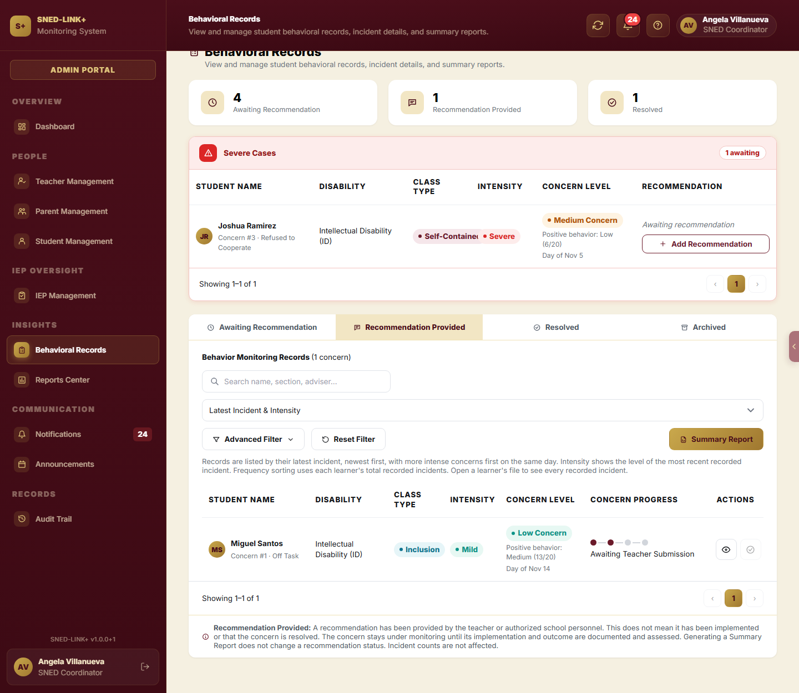

*Behavioral Records: severe cases first, concern level, four-step progress, and Add Recommendation.*

<br/>

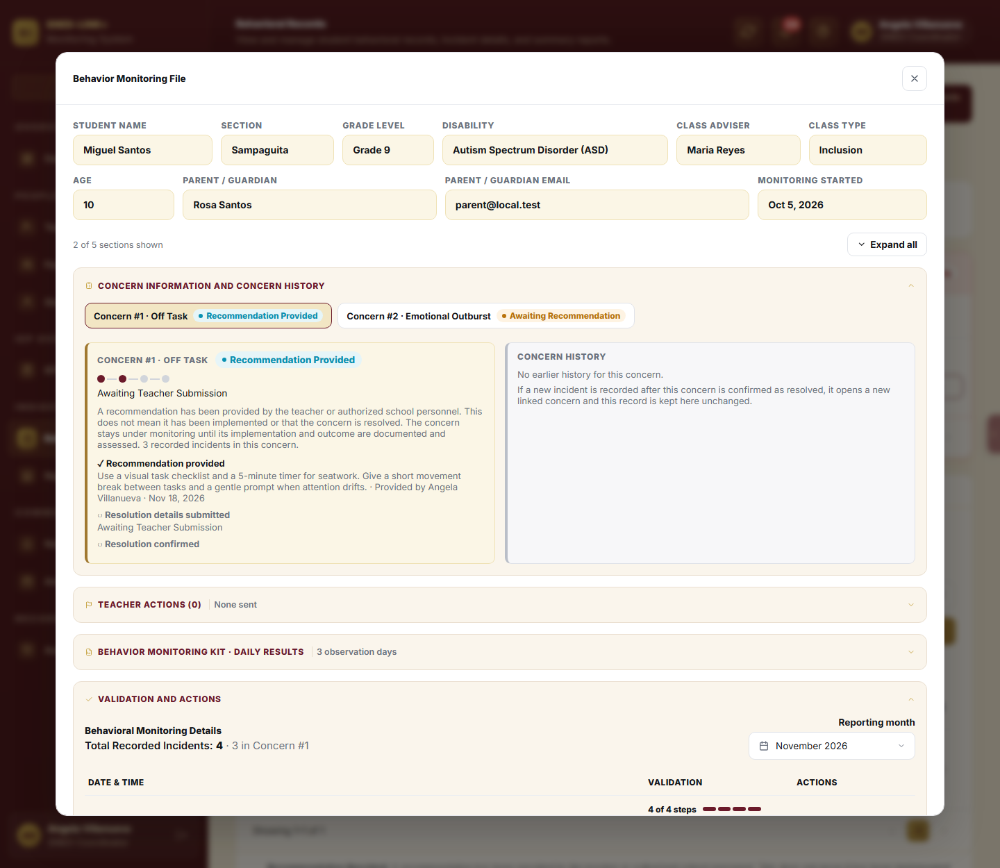

*Behavior Monitoring File: concern history, Teacher Actions, Kit daily results, and the validation steps for every incident.*

<br/>

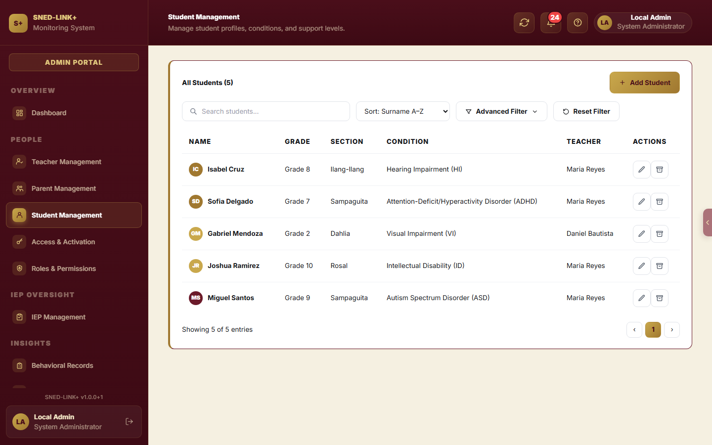

*Student Management: roster, class adviser, search, sort, and Advanced Filter.*

</div>

### Teacher Portal

<div align="center">

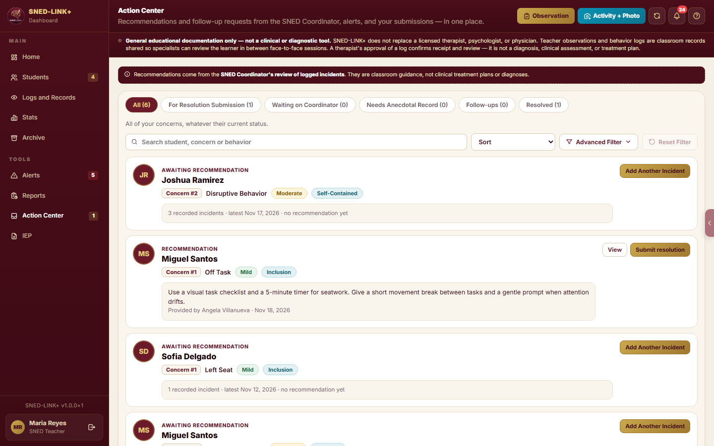

*Action Center: recommendations, follow-ups, and resolution submissions in one place.*

<br/>

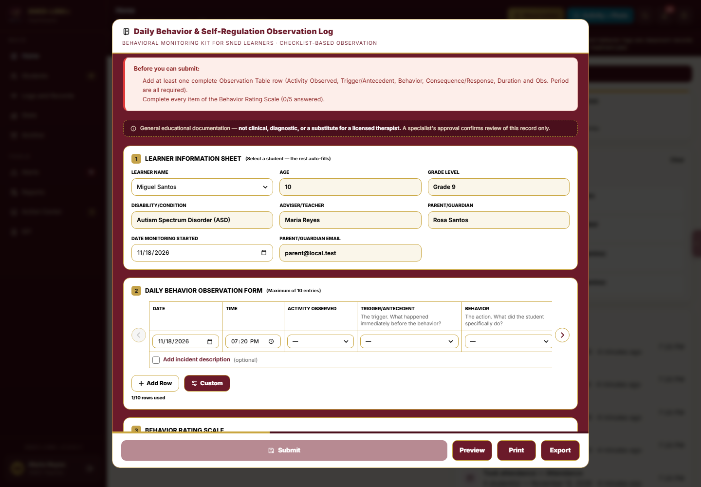

*Behavior Monitoring Kit: a checklist-based Daily Behavior & Self-Regulation Observation Log.*

<br/>

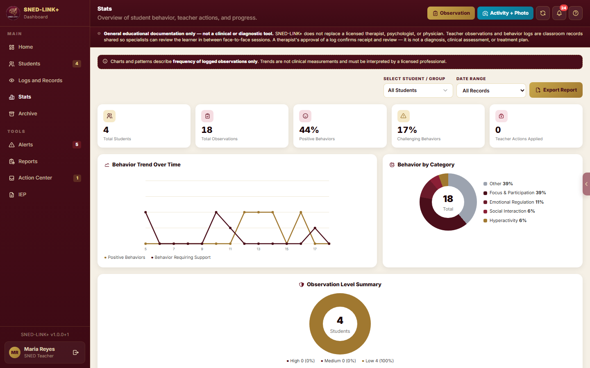

*Stats: behavior trends, categories, and observation levels for the class.*

</div>

### Parent Mobile App

<div align="center">

| Sign in | Home | Behavior |
|:---:|:---:|:---:|
| 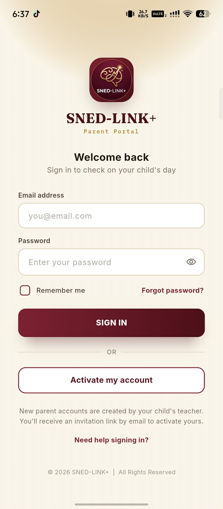 | 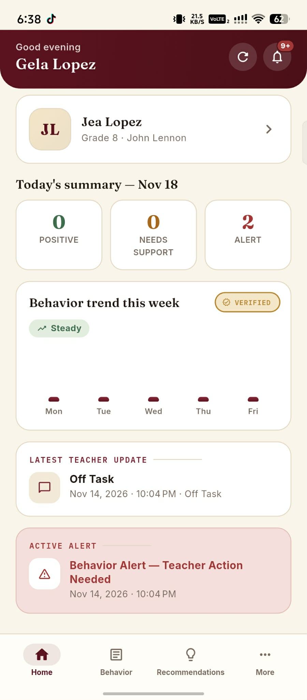 | 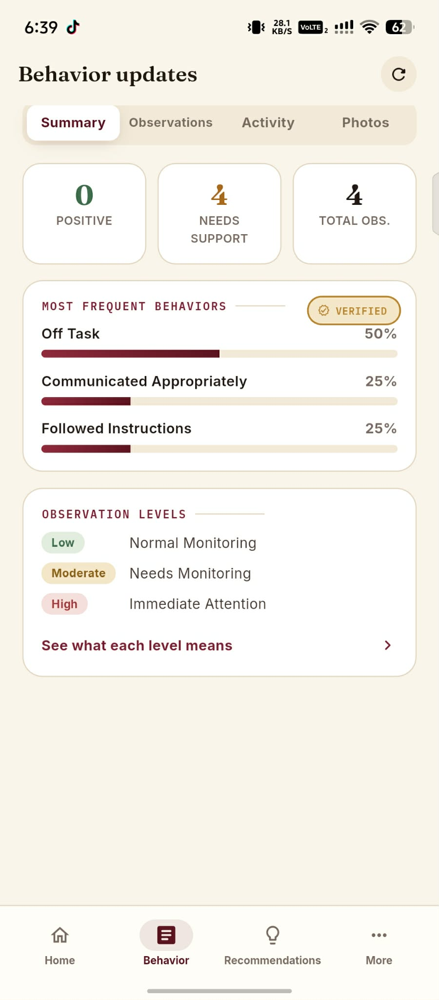 |

| Recommendations | More |
|:---:|:---:|
| 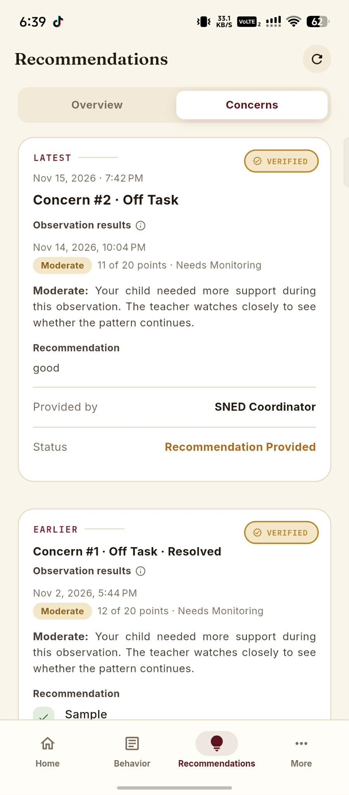 | 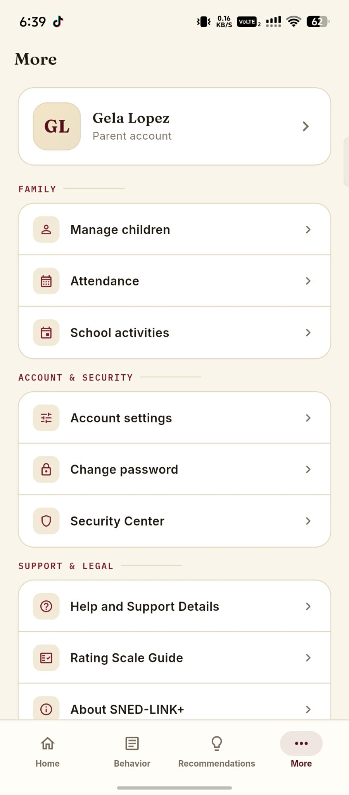 |

</div>

---

## Features

### Teacher Portal
- **Behavior Monitoring Kit:** a structured observation form with up to 10 rows (activity, trigger, behavior, consequence, duration), a 5-item behavior rating scale, custom options, preview, print, and export
- **Share with parents:** the teacher chooses whether an observation is shared, and can email its summary to linked parent accounts
- **Action Center:** one inbox for the Coordinator's recommendations, follow-up requests, anecdotal records, and resolved concerns, with search, sort, and Advanced Filter
- **Teacher Action:** for consecutive repeated behavior, a monthly pattern report and a message to the parent, which the Coordinator can see
- **Students, attendance, activities and photos, IEP, alerts, notifications, and reports**
- **Logs and Records:** twelve log types in one searchable, exportable view
- **Stats:** behavior trends and observation levels, without clinical claims

### Admin Portal and SNED Coordinator
- **Behavioral Records:** four tabs (Awaiting Recommendation, Recommendation Provided, Resolved, Archived), severe cases first, concern level, and progress tracking
- **Behavior Monitoring File:** concern history, Kit daily results, validation steps, Teacher Actions, and monthly summary and pattern reports
- **Role separation:** the Coordinator validates, classifies, recommends, and confirms; the Administrator can only view behavioral records
- **User management:** teachers, parents, and students, with evidence-based parent-to-child linking, access and activation, and **Roles & Permissions**
- **IEP oversight, Reports Center, announcements and school events**
- **Audit Trail** and a real **Archive** (archived learners, inactive accounts, and earlier IEP versions can be restored)
- **Overdue notices** for anecdotal records and follow-ups, sent once

### Parent Mobile App
- **Secure onboarding:** accounts are created by the school and activated through an emailed invitation; sign-in has show/hide password, "Remember me", and password recovery
- **Home:** child switcher, today's summary (*Positive*, *Needs Support*, *Alert*), weekly trend, latest teacher update, and active alerts
- **Behavior:** Summary, Observations, Activity, and Photos tabs, with sorting and filtering
- **Observation results and computation:** the Kit's entries, rate per hour, total duration, and rating-scale level explained in plain language
- **Recommendations and concerns:** concern timeline, results out of 20 points, and the Coordinator's recommendation with its status
- **Rating Scale Guide**, notifications, attendance, school activities, Security Center, and Help & Support (with tutorial links)

### Across the whole system
- Realtime updates over WebSocket, with a polling fallback
- Session management: inactivity timeout, forced sign-out, and device-aware sessions
- Admin and Teacher portal switch without signing out again
- Data privacy by role: parents only ever see what is shared with them

---

## Tech Stack

| Layer | Technology |
|---|---|
| Parent mobile app | Flutter, Dart, Riverpod, go_router, Dio |
| Admin & Teacher web app | React 19, TypeScript, Vite, Zustand, React Router |
| Desktop wrapper | [Wails](https://wails.io/) (Go) |
| Backend / API | Go, Gin, pgx |
| Database | PostgreSQL (hosted on Supabase) with versioned, additive migrations |
| Auth | JWT access and refresh tokens, role- and permission-based access, email invitation activation |
| Realtime | WebSocket push |
| Email | Transactional email through SMTP or an HTTPS mail provider |

---

## Architecture

```
┌──────────────────┐      ┌─────────────────────────────┐
│ Parent Mobile App│      │ Admin & Teacher Web App     │
│ (Flutter)        │      │ (React) + Wails desktop     │
└────────┬─────────┘      └──────────────┬──────────────┘
         │      REST + WebSocket         │
         └──────────────┬────────────────┘
                        ▼
               ┌─────────────────┐
               │   Go REST API   │
               │ roles · audit   │
               │ realtime · mail │
               └────────┬────────┘
                        ▼
               ┌─────────────────┐
               │   PostgreSQL    │
               └─────────────────┘
```

---

## Source Code

This is a **client project**, so the source code is private and not publicly available. This repository is a showcase of the system only.

If you'd like to know more about how it was built, feel free to reach out through my GitHub profile: **[github.com/jhaylm-dev](https://github.com/jhaylm-dev)**.

---

## Author

Full stack development of the whole platform: the Flutter parent app, the React web portals, the Wails desktop packaging, and the Go backend with its database design.

**Jhay Landrei Marcelino**: Full-Stack Software Developer (Flutter, Dart, Go, Python, C#/.NET) based in Laguna, Philippines.

---

## Notes

Screenshots use sample/demo data. This repository is a portfolio showcase of a client project; the source code is not included.

© 2026 SNED-LINK+. All rights reserved.
